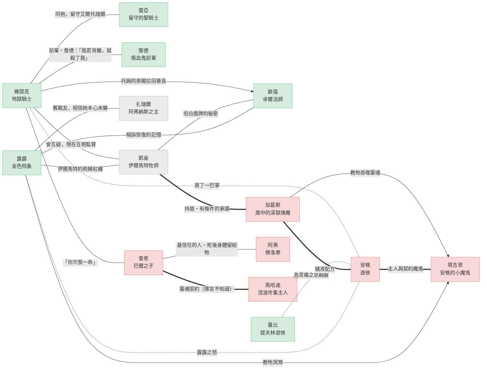

# 人物關係

六名主角從博德之門一路打進湧血城寨，途中幾乎每個人都換過一次陣營。這張圖整理他們彼此之間，以及和幾位重要 NPC 的關係，資料截至[露露的回憶：艾德爾格蘭](episodes/rec-0051.md)。

**綠色**的人物靠近托姆與善良，**紅色**的人物靠近契約與邪惡；拿著加葛斯之盾的[凱侖](characters/凱侖.md)和墮落的天使[扎瑞爾](npcs/扎瑞爾.md)站在中間，以**灰色**表示。點圖上的人物可以打開他的頁面。

連線的意思：**實線**是信任與守護，**虛線**是衝突與責備，**粗線**是契約與交易，**箭頭**是指導或施予（指向接受的一方）。

## 關係一覽

| 關係 | 類型 | 說明 |
| --- | --- | --- |
| [維提克](characters/維提克.md) → [歐蓓](characters/歐蓓.md) | 信任 | 以托姆的恩賜（聖劍誓詞）把她拉回善良（[滅魔器與獨角獸](episodes/monkie-2.md)） |
| 維提克 — [凱侖](characters/凱侖.md) | 信任 | 曾互相猜疑；凱侖點破維提克的改變，現在兩人互相監督（[九根權杖](episodes/rec-0045.md)、[伊爾馬特的紅繩](episodes/rec-0047.md)） |
| 維提克 — [奎恩](characters/奎恩.md) | 信任 | 奎恩被魔物抓上高空摔下時，維提克把他救起（[沸血湖的魔鄧肯](episodes/rec-0048.md)） |
| 維提克 — [安格](characters/安格.md) | 衝突 | 安格殺死被詛咒的守衛後，維提克賞了他一巴掌（[露露的回憶：艾德爾格蘭](episodes/rec-0051.md)） |
| 維提克 — [詹德](npcs/詹德.md) | 信任 | 獻血救活的前輩；詹德把「若我背離地獄騎士精神就殺了我」的信任交給維提克（[學長是個超級吸血鬼是否搞錯了甚麼](episodes/2025-12-2.md)、[九根權杖](episodes/rec-0045.md)） |
| 維提克 — [雷亞](npcs/雷亞.md) | 信任 | 地獄騎士同袍，雷亞留守艾爾托瑞爾（[在阿弗納斯行軍然後拿到穢液](episodes/2025-11-08.md)） |
| 凱侖 — 歐蓓 | 信任 | 凱侖向歐蓓坦白盾牌的秘密與對信仰的迷茫（[貝爾的委託](episodes/rec-0041.md)） |
| [蓋比](characters/蓋比.md) — 安格 | 衝突 | 蓋比射向苦痛之息的箭被安格擋下，之後親手處決了對方（[苦痛之息的審判](episodes/rec-0039.md)） |
| 凱侖 — [加葛斯](items/加葛斯之盾.md) | 契約 | 持盾，承諾若加葛斯真的幫忙拯救艾爾托瑞爾，就想辦法幫他（[奧蘭蘇斯的日記](episodes/monkie-4.md)、[血痂裡的城寨](episodes/rec-0049.md)） |
| 加葛斯 — 安格 | 契約 | 給安格穢液配方（[松江南京站](episodes/songjiang.md)、[伊爾馬特的紅繩](episodes/rec-0047.md)） |
| 加葛斯 → 塔吉恩 | 指導 | 教安格的小魔鬼吞噬靈魂，安格不知情（[奧蘭蘇斯的日記](episodes/monkie-4.md)） |
| 安格 — 塔吉恩 | 契約 | 主人與契約魔鬼 |
| [露露](npcs/露露.md) → 塔吉恩 | 指導 | 教牠冥想，說要讓善良遍布世界（[艦橋上的冥想](episodes/rec-0044.md)） |
| 露露 — 凱侖 | 信任 | 露露在冥想中得到伊爾馬特的荊棘紅繩，可以用來幫助凱侖（[伊爾馬特的紅繩](episodes/rec-0047.md)） |
| 露露 — 歐蓓 | 信任 | 露露最常說話的對象，向歐蓓傾訴恢復的記憶 |
| 露露 — [扎瑞爾](npcs/扎瑞爾.md) | 信任 | 舊戰友，相信她的本心未變 |
| 露露 — 安格 | 衝突 | 露露之怒：安格殺死被詛咒的平民後，獲得一級力竭（[露露的回憶：艾德爾格蘭](episodes/rec-0051.md)） |
| 奎恩 — [阿弗](npcs/阿弗.md) | 信任 | 阿弗最信任奎恩；依契約，奎恩死後的身體會留給阿弗，阿弗本人不知道（[思考魔生的阿弗](episodes/2025-10-25.md)、[羅剎之歌](episodes/rec-0040.md)） |
| 奎恩 — [馬哈迪](npcs/馬哈迪.md) | 契約 | 死後靈魂歸阿斯莫蒂斯，換弟弟變回普通人，隊友不知道（[羅剎之歌](episodes/rec-0040.md)） |

圖上沒有畫、寫在各角色頁裡的關係：歐蓓對安格的勸說、蓋比與歐蓓的身世談話、奎恩對詹德的猜疑。
